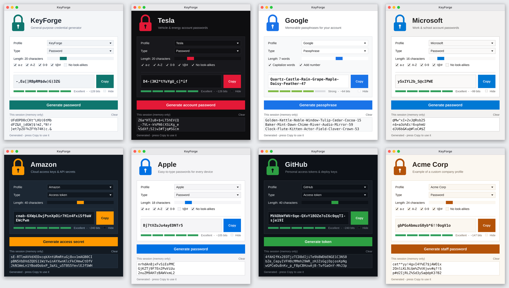
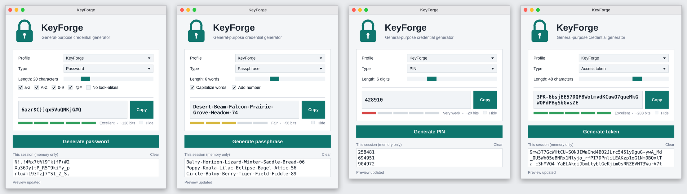

# KeyForge

A themeable, general-purpose credential generator with a desktop GUI (tkinter) and a CLI
Generate **passwords, passphrases, PINs and access tokens**, switch between **brand profiles** (Tesla, Google, Microsoft, Amazon, Apple, GitHub, or your own), and copy the result to the clipboard - which is cleared automatically after 30 seconds



## Quick start

Requires Python 3.9+. No third-party packages are needed to run the app.

```bash
python -m keyforge                       # open the GUI
python -m keyforge --profile tesla       # open the GUI on a specific profile
python -m keyforge --cli --profile google --count 3
python -m keyforge --cli --mode pin --length 6
python -m keyforge --list-profiles
```

If `tkinter` isn't installed (e.g. minimal Linux: `sudo apt install python3-tk`), the app falls back to CLI output automatically

## Profiles

A profile = **theme** (colours) + **default policy** (type, length, rules) + **button wording**
They live in `keyforge/profiles.json`. Add your own without touching the code:

```json
{
  "profiles": [
    {
      "id": "myteam",
      "name": "My Team",
      "tagline": "Internal service accounts",
      "action_label": "Generate service password",
      "theme":  { "accent": "#7c3aed", "bg": "#faf5ff" },
      "policy": { "mode": "password", "length": 28, "avoid_ambiguous": true }
    }
  ]
}
```

```bash
python -m keyforge --profiles myteam.json --profile myteam
```

Same `id` as a built-in = override it. Invalid colours/policies are rejected with a clear error

| Policy field | Meaning |
|---|---|
| `mode` | `password`, `passphrase`, `pin`, `token` |
| `length` | characters (words for passphrases). Ranges: password 8-64, passphrase 3-10, PIN 4-12, token 16-64 |
| `lower` `upper` `digits` `symbols` | character classes (password mode); each enabled class is guaranteed to appear |
| `symbol_set` | which symbols to draw from |
| `avoid_ambiguous` | drop look-alikes `O 0 o I l 1 \|` |
| `separator` `capitalize` `add_number` | passphrase formatting |

> **Trademark / affiliation note.** Company names are trademarks of their respective owners. The built-in company profiles are *illustrative presets*: they borrow a colour palette and a sensible default policy, use a generic padlock (not any company's logo), and are **not** official password policies. KeyForge is not affiliated with or endorsed by any of them



## Security notes

- Randomness comes from Python's `secrets` (OS CSPRNG), never `random`
- **Nothing is written to disk.** Credentials live in memory for the session only; there is no password file. "Clear" empties the session list; closing the window discards everything
- Clipboard is cleared 30 s after copying (only if it still holds the copied value)
- Strength is an *estimate* in bits from the alphabet / word-list size. The built-in passphrase list has ~300 words (~8.2 bits/word), which is why 7 words are used by default
- This tool generates secrets; it does not store or manage them. Use a password manager for storage

## Project layout

```
keyforge/
  core.py        generation engine (pure Python, fully unit-tested)
  profiles.py    JSON profile loader + validation
  profiles.json  built-in profiles
  branding.py    code-drawn padlock logo + colour helpers (no image assets)
  words.py       passphrase word list
  gui.py         tkinter interface
  __main__.py    CLI / launcher
tests/           unittest suite (core, profiles, CLI, GUI wiring)
tools/           render_previews.py - regenerates the screenshots
screenshots/     previews of every profile
```
